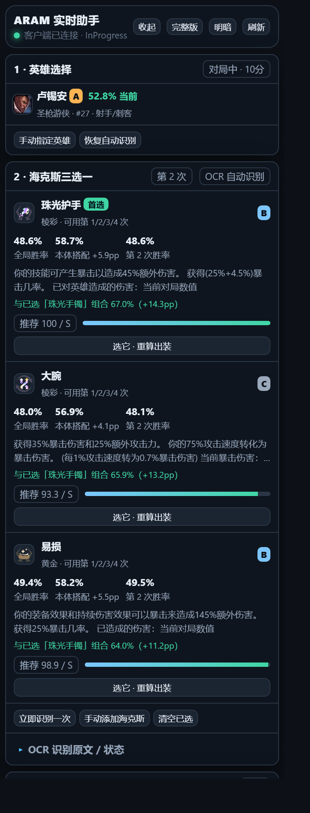

# ARAM 海克斯大乱斗实时助手

给英雄联盟**海克斯大乱斗（ARAM Mayhem）**用的本地浮窗工具：对局里在屏幕右上角开一个小窗，告诉你海克斯三选一拿哪张胜率高、下一件装备该买什么。

## 它能干什么

- **海克斯三选一**：每张卡的全局胜率 / 选取率 / 梯队，搭配你当前英雄和已选海克斯的组合胜率，按综合分排序，点一下记录选取。
- **出装与顺序**：出门装 → 鞋子 → 核心成装的真实购买路线，随已选海克斯切换专属样本；可手动指定流派（暴击 / 穿甲 / 坦克等）；按你**已经买到的装备**继续推荐下一件，并列出该件位胜率最高的 3 个。
- **智能浮窗**：平时缩成一个小胶囊不挡画面，只在选海克斯、开商店时自动展开；聊天里你的选取广播会被自动识别记录。
- **敌方针对**：看对面阵容偏物理还是法系，给重伤 / 护甲 / 魔抗 / 穿透的针对性提示。

## 下载与使用

- **免安装版（推荐）**：到 [Releases](https://github.com/langopt000/aram-assistant/releases/tag/v1.0.0) 下载 `ARAM-Assistant-portable.zip`，解压到任意目录双击「启动助手.bat」即可，不用装 Python 或任何依赖（仅 Windows 10/11 64 位）。退出双击「退出助手.bat」，详见包内「使用说明.txt」。
- **源码运行**：见 [aram-assistant/](aram-assistant/)，纯 Python 3 标准库、零第三方依赖，界面是单文件 HTML。

## 原理与隐私

- 数据来自 aramkit.cn 同源的公开统计（高分段、日更），本地缓存。
- 识别靠 Windows 自带 OCR + 屏幕截取（海克斯卡面、商店、聊天广播），**不读游戏内存、不改任何游戏数据**。
- 服务只跑在本机 `127.0.0.1:8765`，不上传任何数据。

## 注意

- 是否使用请自行确认所在服务器的规则，本工具只提供信息参考。
- OCR 依赖 Windows 中文语言包；全屏独占模式下浮窗可能被压住，改窗口化即可。

## 目录

| 目录 | 说明 |
|---|---|
| `aram-assistant/` | 助手本体：源码、界面与文档（[README](aram-assistant/README.md) / [HANDOVER](aram-assistant/HANDOVER.md)） |